<div align="center">

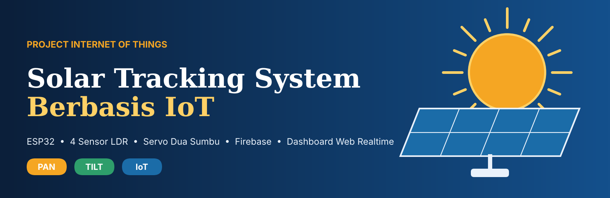

<br>


**Panel surya yang "mengejar" cahaya, bisa dipantau dan dikendalikan dari mana saja lewat website.**

[Fitur](#fitur-utama) •
[Arsitektur](#arsitektur-sistem) •
[Rangkaian](#diagram-rangkaian) •
[Dashboard](#dashboard-web) •
[Cara Menjalankan](#cara-menjalankan) •
[Dokumen](#dokumen-pendukung)

</div>

---

## Tentang Project

Panel surya yang dipasang tetap hanya bekerja optimal pada satu posisi matahari. **Solar Tracking System** ini menggerakkan panel pada **dua sumbu** (PAN kiri-kanan dan TILT atas-bawah) mengikuti arah cahaya yang dibaca oleh **4 sensor LDR**. Ditambah lapisan **IoT**: data sensor dikirim ke **Firebase Realtime Database**, lalu ditampilkan di **dashboard web** yang juga bisa **mengontrol servo secara realtime** (joystick, tombol panah, bahkan controller gaming).

Project ini dibuat untuk mata kuliah **Internet of Things** dan dipamerkan pada pameran tugas akhir.

<div align="center">

| | |
|:---:|:---:|
| 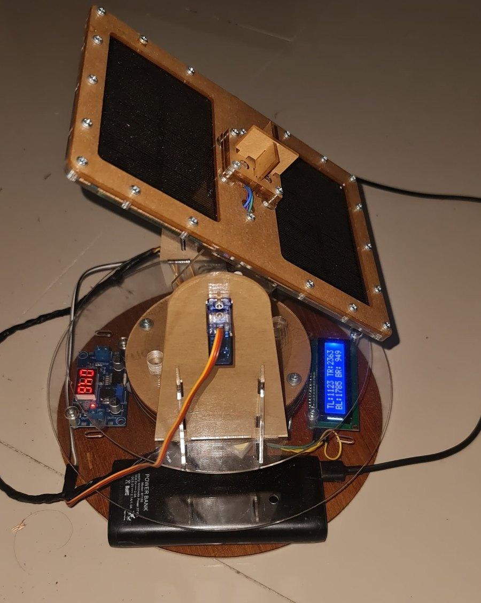<br><sub>Prototipe tampak depan</sub> | 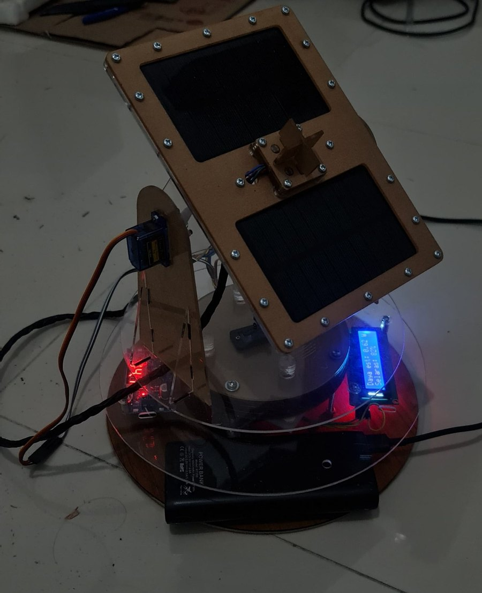<br><sub>Panel miring mengikuti cahaya</sub> |

</div>

## Daftar Isi

- [Fitur Utama](#fitur-utama)
- [Arsitektur Sistem](#arsitektur-sistem)
- [Cara Kerja](#cara-kerja)
- [Komponen](#komponen)
- [Diagram Rangkaian](#diagram-rangkaian)
- [Pemetaan Pin](#pemetaan-pin)
- [Struktur Data Firebase](#struktur-data-firebase)
- [Dashboard Web](#dashboard-web)
- [Cara Menjalankan](#cara-menjalankan)
- [Parameter yang Dapat Disetel](#parameter-yang-dapat-disetel)
- [Estimasi Daya dan Kalibrasi](#estimasi-daya-dan-kalibrasi)
- [Hasil Pengujian](#hasil-pengujian)
- [Troubleshooting](#troubleshooting)
- [Keamanan](#keamanan)
- [Struktur Repositori](#struktur-repositori)
- [Pengembangan Selanjutnya](#pengembangan-selanjutnya)
- [Dokumen Pendukung](#dokumen-pendukung)

## Fitur Utama

| | Fitur | Penjelasan |
|:---:|---|---|
| ☀️ | **Tracking otomatis dua sumbu** | 4 LDR dengan sekat silang; servo PAN dan TILT mengikuti cahaya secara proporsional dan halus |
| 🎮 | **Kontrol manual realtime** | Joystick virtual, tombol panah, keyboard, hingga controller fisik (ROG/Xbox) lewat Gamepad API |
| 📡 | **Monitoring IoT** | Cahaya, posisi servo, status tracking, kekuatan Wi-Fi, dan status ONLINE/OFFLINE |
| ⚡ | **Estimasi daya masuk** | Daya (W), keselarasan panel (%), dan energi (Wh), dapat dikalibrasi dengan multimeter |
| 🗄️ | **Riwayat di database** | Pengukuran tersimpan otomatis di Firebase, dengan grafik, ringkasan, dan unduh CSV |
| 🔋 | **Energi mandiri** | Panel → modul charging MPPT → baterai 2S → LM2596 (5 V) → ESP32, servo, LCD |
| 📟 | **LCD I2C 16×2** | 4 halaman bergantian: posisi servo, nilai LDR, estimasi daya, status Wi-Fi/Firebase |
| 🛡️ | **Pengaman** | Batas sudut servo dan kembali ke mode AUTO bila koneksi kontrol putus 20 detik |

## Arsitektur Sistem

<div align="center">
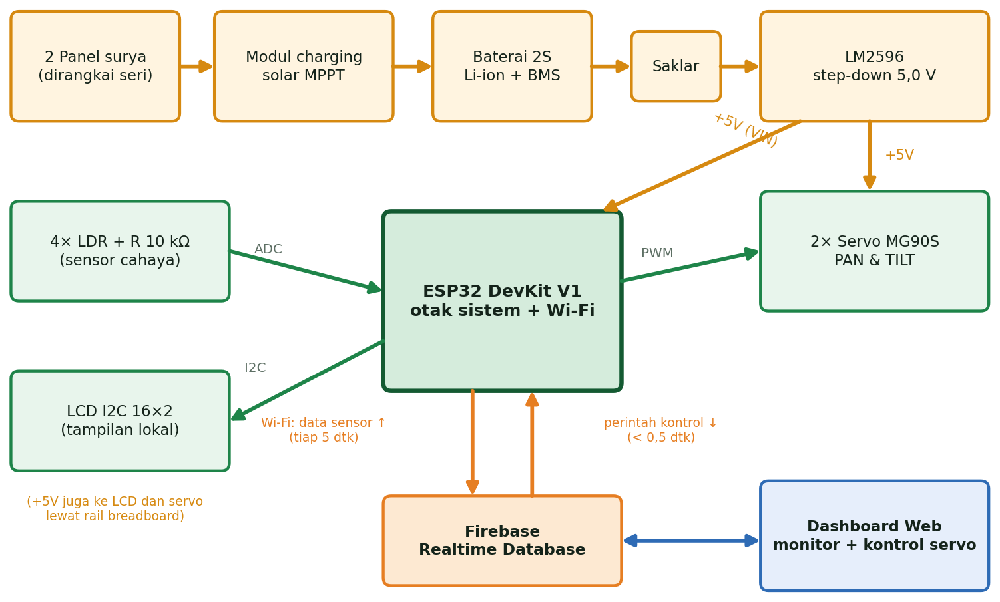
</div>

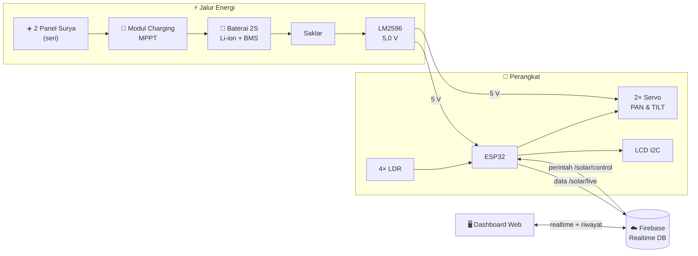

## Cara Kerja

### Mode AUTO: mengikuti cahaya

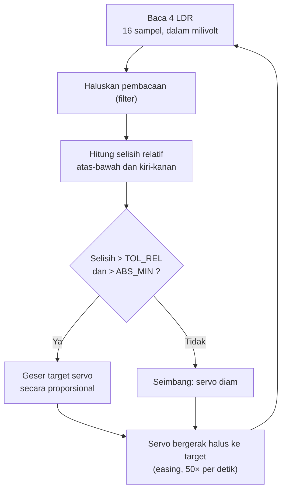

Servo bereaksi pada **selisih relatif** antar-LDR, bukan angka mutlak, sehingga tetap peka pada cahaya redup atau senter yang jauh:

```
selisih relatif = (A − B) / (A + B)        A, B = rata-rata LDR pada sisi yang berlawanan
```

### Mode MANUAL: kontrol dari website

1. Pilih **MANUAL** di dashboard (target dimulai dari posisi servo saat itu, tanpa melompat).
2. Geser joystick, tekan panah, atau pakai controller; sudut target dikirim ke `/solar/control`.
3. ESP32 membaca perintah (kurang dari 0,5 detik) dan menggerakkan servo secara halus.
4. Pilih **AUTO** untuk kembali mengikuti cahaya.

> **Kenapa tidak tersendat?** Komunikasi Firebase dijalankan di **task terpisah pada core 0**, sedangkan sensor dan servo berjalan di **core 1** setiap 20 ms. Proses jaringan yang lambat tidak lagi menghentikan servo.

## Komponen

| Komponen | Jumlah | Fungsi |
|---|:---:|---|
| ESP32 DevKit V1 (30 pin) | 1 | Mikrokontroler + Wi-Fi 2,4 GHz |
| Servo MG90S | 2 | Gerak PAN (kiri-kanan) dan TILT (atas-bawah) |
| LDR GL5528 + resistor 10 kΩ | 4 | Sensor arah cahaya (TL, TR, BL, BR) |
| Panel surya 11 × 7 cm | 2 | Sumber energi (dirangkai seri) |
| Modul charging solar MPPT (CN3722) | 1 | Mengisi baterai dari panel |
| Baterai Li-ion 18650 2S + BMS | 1 | Penyimpan energi (kelas 9 V) |
| LM2596 step-down | 1 | Menurunkan tegangan ke 5,0 V |
| LCD 16×2 + modul I2C | 1 | Tampilan lokal |
| Breadboard mini 8,5 × 5,5 cm | 1 | Jalur daya (rail +5 V dan GND) |
| Kapasitor 1000 µF, saklar, kabel jumper | 1 set | Peredam lonjakan arus servo, pemutus daya, penghubung |

## Diagram Rangkaian

<div align="center">
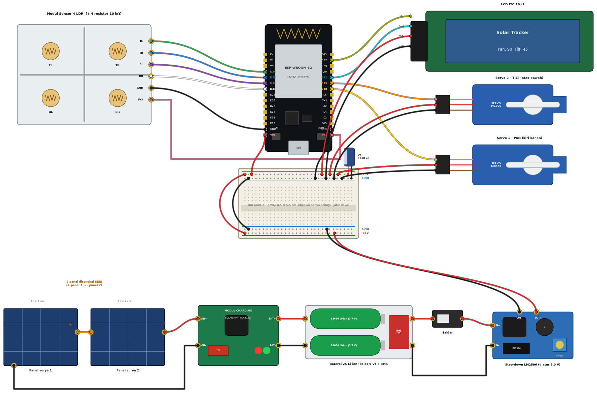
<br><sub>Diagram lengkap. Breadboard hanya dipakai sebagai jalur daya.</sub>
</div>

<details>
<summary><b>Jalur daya (panel → modul charging → baterai → LM2596)</b></summary>
<br>
<div align="center">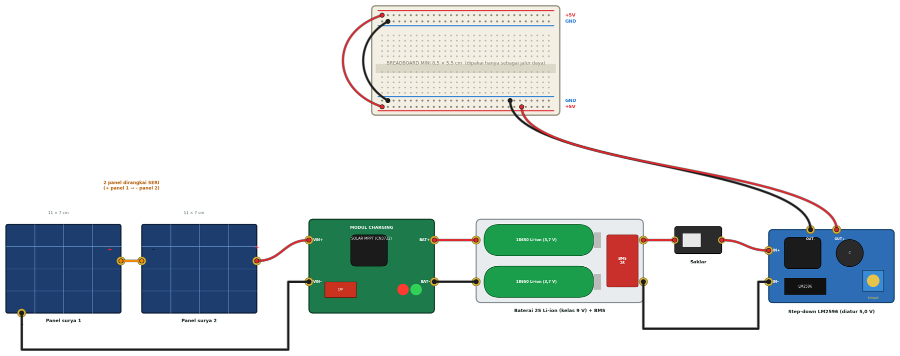</div>

Dua panel dirangkai **seri** agar tegangannya di atas baterai. Modul charging **harus diatur ke Li-ion 2S 8,4 V** sebelum baterai dipasang. LM2596 diatur **5,0 V** sebelum disambung ke ESP32.
</details>

<details>
<summary><b>Sensor 4 LDR (3V3 dan GND digabung, hanya 6 kabel)</b></summary>
<br>
<div align="center">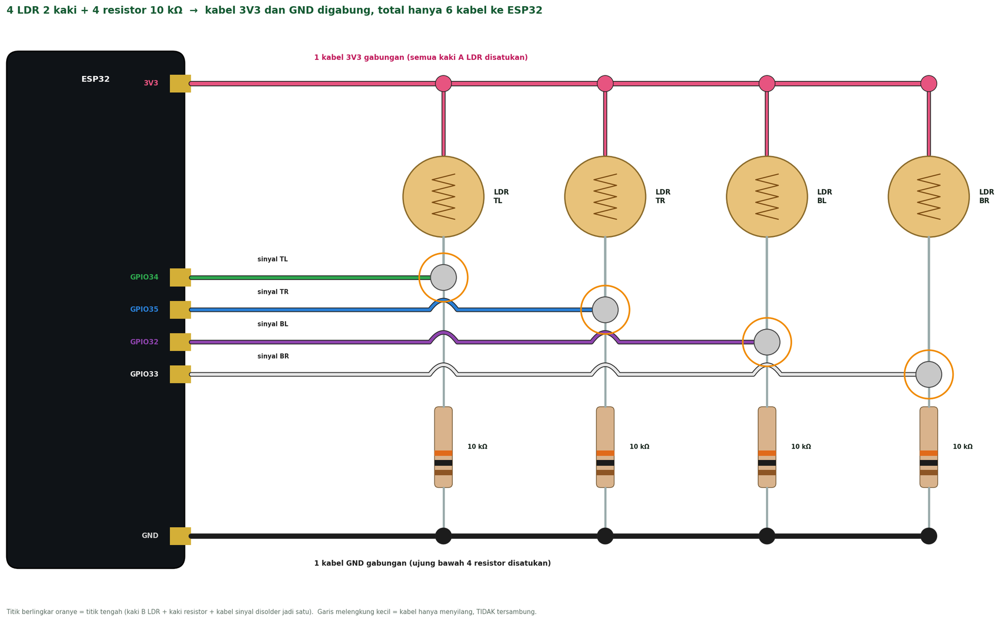</div>

Tiap LDR berpasangan dengan resistor 10 kΩ sebagai pembagi tegangan: makin terang, nilai ADC makin besar. Kaki 3V3 keempat LDR disatukan, ujung GND keempat resistor disatukan, dan 4 kabel sinyal ke GPIO34, 35, 32, 33.
</details>

<details>
<summary><b>Servo dan LCD I2C</b></summary>
<br>
<div align="center">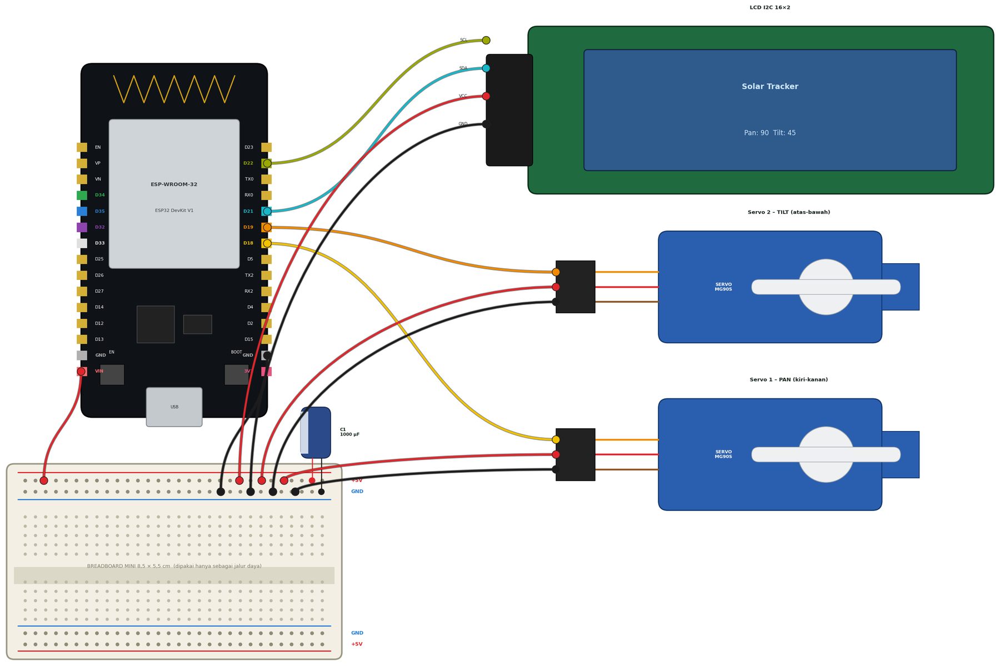</div>
</details>

## Pemetaan Pin

| Bagian | Pin ESP32 |
|---|:---:|
| LDR kiri-atas (TL) | GPIO 34 |
| LDR kanan-atas (TR) | GPIO 35 |
| LDR kiri-bawah (BL) | GPIO 32 |
| LDR kanan-bawah (BR) | GPIO 33 |
| Servo PAN | GPIO 18 |
| Servo TILT | GPIO 19 |
| LCD SDA | GPIO 21 |
| LCD SCL | GPIO 22 |
| LDR (3V3), GND | pin 3V3, pin GND |
| Catu 5 V (ESP32, servo, LCD) | VIN / rail +5 V dari LM2596 |

> Semua pembacaan analog memakai **ADC1** (GPIO32-39) agar tetap bekerja saat Wi-Fi aktif.

## Struktur Data Firebase

```text
solar
├── live          ← ditulis ESP32 (tiap 5 detik)
│   ├── ldr { tl, tr, bl, br }
│   ├── servo { az, el }
│   ├── light, align, pest, ewh, wp
│   ├── dv, dh, mode, status
│   └── rssi, uptime, ts
├── control       ← ditulis website
│   ├── mode      "auto" | "manual"
│   └── az, el    sudut target PAN (0-180) dan TILT (0-90)
├── history       ← ditulis website (satu data per interval simpan)
│   └── {waktu}   ts, light, align, pest, ewh, az, el, mode, status, tl..br, rssi
└── calibration   ← faktor kalibrasi daya (factor, measured, raw, ts)
```

## Dashboard Web

<div align="center">
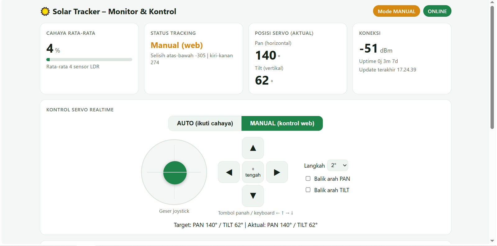
</div>

- **Monitoring realtime**: cahaya, status tracking, posisi servo, Wi-Fi, ONLINE/OFFLINE
- **Kontrol servo**: AUTO/MANUAL, joystick virtual, tombol panah (tahan = berulang), tombol tengah, pilihan langkah 1/2/5/10°
- **Controller fisik** (ROG/Xbox): stick = joystick, D-pad = panah, **A** = tengah, **Start** = AUTO/MANUAL, **LB/RB** = ubah langkah
- **Estimasi daya masuk** dengan kalibrasi multimeter
- **Riwayat pengukuran**: simpan otomatis, rentang 1 jam sampai 7 hari, grafik, ringkasan, **unduh CSV**

## Cara Menjalankan

### 1. Rakit perangkat keras
Ikuti diagram di atas dan panduan lengkap pada [`Panduan_Solar_Tracker_IoT_ESP32.pdf`](Panduan_Solar_Tracker_IoT_ESP32.pdf) (10 tahap perakitan, tabel kabel, dan checklist).

### 2. Siapkan Firebase
1. Buat project di [Firebase Console](https://console.firebase.google.com), lalu aktifkan **Realtime Database** (lokasi Singapore).
2. Pasang aturan berikut dan klik **Publish**:

```json
{
  "rules": {
    ".read": false,
    ".write": false,
    "solar": { ".read": true, ".write": true }
  }
}
```
3. Salin **URL database** dan `firebaseConfig` dari *Project settings → Your apps → Web*.

### 3. Upload kode ESP32
1. Pasang **Arduino IDE 2.x**, tambahkan board **esp32 (Espressif Systems)**, dan library **ESP32Servo**.
2. Buka [`KODINGAN_IOT_SOLAR_TRACKER.ino`](KODINGAN_IOT_SOLAR_TRACKER.ino) dan isi:

```cpp
const char* WIFI_SSID = "NAMA_WIFI";        // jaringan 2,4 GHz
const char* WIFI_PASS = "PASSWORD_WIFI";
const char* DB_URL    = "https://NAMA-PROJECT-default-rtdb.asia-southeast1.firebasedatabase.app"; // tanpa "/" di akhir
const float PANEL_WP  = 2.0f;               // daya puncak total 2 panel (Wp)
```
3. Pilih board **ESP32 Dev Module**, pilih port, lalu **Upload** (tahan tombol BOOT bila perlu).

### 4. Jalankan dashboard
Buka [`index.html`](index.html), ganti blok `firebaseConfig` dengan milik Anda, lalu buka file di browser (Chrome/Edge). Untuk akses dari HP, gunakan Firebase Hosting:

```bash
npm install -g firebase-tools
firebase login
firebase init hosting     # public directory = folder berisi index.html
firebase deploy
```

## Parameter yang Dapat Disetel

Semua ada di bagian atas kode ESP32 (nilai bawaan):

| Parameter | Nilai | Fungsi |
|---|:---:|---|
| `TOL_REL` | 0,03 | Selisih relatif yang dianggap seimbang. Kecil = lebih peka |
| `ABS_MIN` | 10 | Selisih ADC minimum agar noise tidak dianggap cahaya |
| `GAIN_REL` | 25 | Makin besar, servo makin cepat mengejar cahaya |
| `AUTO_MAX_STEP` | 3,0 | Langkah maksimum per 20 ms (3,0 = 150°/detik) |
| `EASE` | 0,40 | Kelembutan gerak servo (kecil = lebih lembut) |
| `MAX_SPEED` | 4,0 | Kecepatan maksimum servo (derajat per 20 ms) |
| `LDR_SMOOTH` | 0,6 | Penghalus LDR (kecil = lebih stabil, lebih lambat) |
| `DIR_AZ` / `DIR_EL` | 1 | Ubah ke -1 bila arah gerak servo terbalik (mode AUTO) |
| `PANEL_WP` | 2,0 | Daya puncak total kedua panel (Wp) |

## Estimasi Daya dan Kalibrasi

Rangkaian ini **tidak mengukur tegangan atau arus panel**, jadi daya yang tampil adalah **estimasi** dari sensor cahaya:

```
Daya estimasi (W) = Daya puncak × Cahaya (%) × Keselarasan × Faktor kalibrasi
Keselarasan       = 1 − (selisih relatif atas-bawah + kiri-kanan)
```

**Kalibrasi dengan multimeter** langsung dari dashboard: ukur daya panel dengan multimeter, isi pada kotak *daya terukur*, lalu klik **Kalibrasi sekarang** saat kondisi cahaya sama dengan saat pengukuran. Faktor disimpan di Firebase dan dipakai oleh semua perangkat.

> ⚠️ Faktor dihitung dari satu titik pengukuran, jadi paling akurat di sekitar kondisi cahaya saat kalibrasi. Untuk daya yang sebenarnya, tambahkan sensor arus/tegangan seperti **INA219**.

## Hasil Pengujian

<table>
<tr>
<td align="center" width="50%">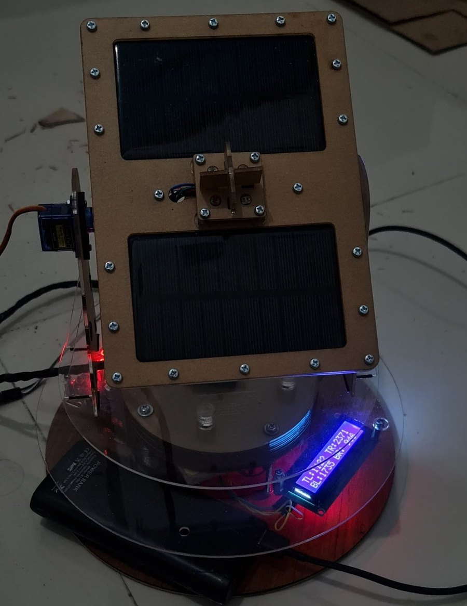<br><sub>Servo TILT dan LCD I2C menyala</sub></td>
<td align="center" width="50%">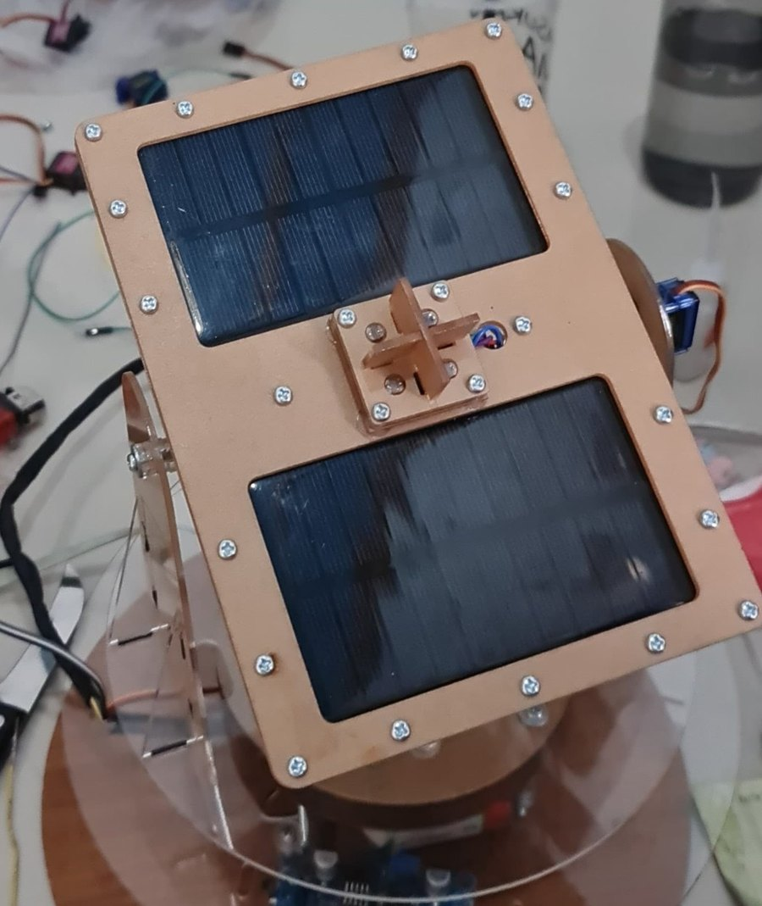<br><sub>Sensor 4 LDR dengan sekat silang</sub></td>
</tr>
</table>

| Pengamatan | Hasil |
|---|---|
| Koneksi Firebase | ONLINE, sinyal Wi-Fi sekitar −51 dBm |
| Kontrol manual dari web | Target = aktual (contoh PAN 140°, TILT 62°) |
| Nilai LDR pada LCD | TL 1123, TR 2363, BL 1785, BR 949 (berbeda antar kuadran sehingga servo mengoreksi) |
| Estimasi daya (sebelum kalibrasi) | 0,6 sampai 1,2 W dari puncak 2 W; pembanding multimeter sekitar 4 W, sehingga fitur kalibrasi ditambahkan |

## Troubleshooting

<details>
<summary><b>Upload gagal: "Serial data stream stopped"</b></summary>

Turunkan **Tools → Upload Speed** ke 115200, pakai kabel USB data yang pendek, pindah port USB, dan tahan tombol **BOOT** saat "Connecting...". Cabut kabel LCD/servo selama upload.
</details>

<details>
<summary><b>LCD menampilkan "WiFi: terputus"</b></summary>

ESP32 hanya mendukung **2,4 GHz**. Pastikan SSID/password benar (huruf besar-kecil), hotspot HP tidak 5 GHz, dan `DB_URL` **tanpa tanda "/" di akhir**. Lihat Serial Monitor (115200) untuk alasan pastinya.
</details>

<details>
<summary><b>Servo tidak mengikuti cahaya (mode AUTO)</b></summary>

Pastikan mode AUTO, lalu cek nilai TL/TR/BL/BR di LCD: tutup satu LDR dengan jari (nilai harus turun) dan sinari dengan senter (nilai harus naik). Jika servo bergerak menjauhi cahaya, ubah `DIR_AZ`/`DIR_EL` menjadi -1. Pastikan sekat silang terpasang dan setiap LDR memiliki resistor 10 kΩ ke GND.
</details>

<details>
<summary><b>Servo tersendat atau ESP32 restart saat servo bergerak</b></summary>

Pastikan kapasitor 1000 µF terpasang di rail +5 V, semua GND menyatu, dan baterai terisi. Bila perlu pakai preset gerak lembut (komentar di bagian parameter kode).
</details>

<details>
<summary><b>Dashboard kosong atau OFFLINE</b></summary>

Periksa `firebaseConfig` di `index.html`, URL database, dan aturan Firebase (**Publish**). Di Serial Monitor harus muncul `Firebase HTTP 200`.
</details>

## Keamanan

> [!WARNING]
> Repositori ini **publik**. Jangan commit **password Wi-Fi** asli. Aturan Firebase pada panduan ini membuka jalur `/solar` untuk dibaca dan ditulis siapa pun yang mengetahui URL database, sehingga **siapa pun dapat menggerakkan servo atau menghapus riwayat**. Ini cukup untuk demo, tetapi setelah pameran **hapus project Firebase** atau perketat aturan dengan **Firebase Authentication**.

## Struktur Repositori

```text
plts-berbasis-solar-tracking-iot/
├── KODINGAN_IOT_SOLAR_TRACKER.ino        # Firmware ESP32 (Arduino)
├── index.html                            # Dashboard web: monitor, kontrol, riwayat
├── Panduan_Solar_Tracker_IoT_ESP32.pdf   # Panduan perakitan lengkap
├── Presentasi_Solar_Tracker_IoT.pptx     # Slide presentasi
├── README.md
└── assets/                               # Gambar untuk README (banner, foto, diagram)
```

## Pengembangan Selanjutnya

- [x] Tracking dua sumbu otomatis berbasis 4 LDR
- [x] Dashboard realtime dengan kontrol manual dan controller fisik
- [x] Riwayat pengukuran di Firebase + unduh CSV
- [x] Estimasi daya dengan kalibrasi multimeter
- [ ] Daya nyata dengan sensor **INA219** (tegangan, arus, watt)
- [ ] ESP32 menulis riwayat langsung (tercatat tanpa dashboard terbuka)
- [ ] **Firebase Authentication** untuk mengamankan kontrol
- [ ] Algoritma posisi matahari dan pengisian baterai berbasis MPPT

## Dokumen Pendukung

| Dokumen | Isi |
|---|---|
| [`Panduan_Solar_Tracker_IoT_ESP32.pdf`](Panduan_Solar_Tracker_IoT_ESP32.pdf) | Daftar bahan, diagram, tabel kabel, 10 tahap perakitan, Firebase, kalibrasi, troubleshooting, dan kode lengkap |
| [`Presentasi_Solar_Tracker_IoT.pptx`](Presentasi_Solar_Tracker_IoT.pptx) | Slide presentasi project (18 slide) |

---

<div align="center">

Dibuat dengan ☀️ oleh [**ilhamsyauqih**](https://github.com/ilhamsyauqih) dan tim untuk mata kuliah **Internet of Things**.

</div>
